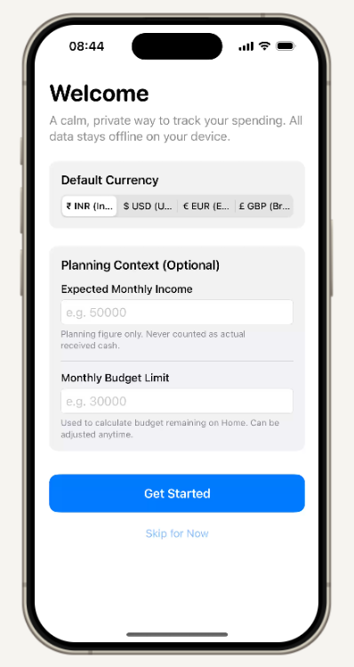
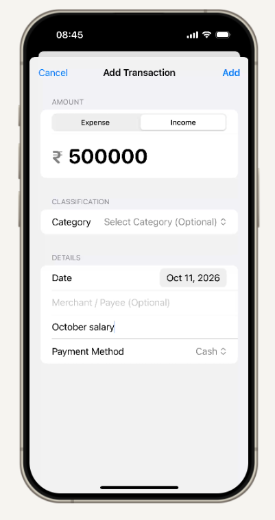
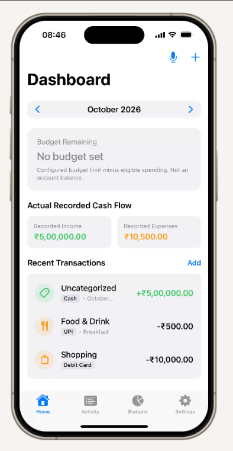
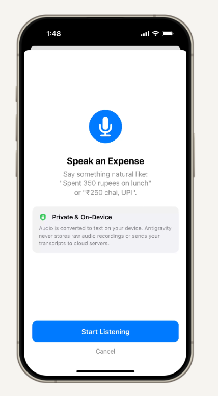
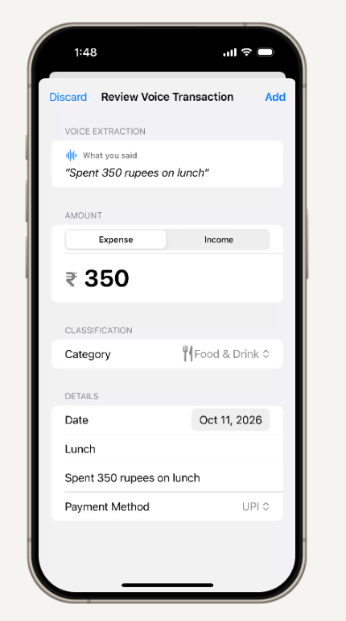
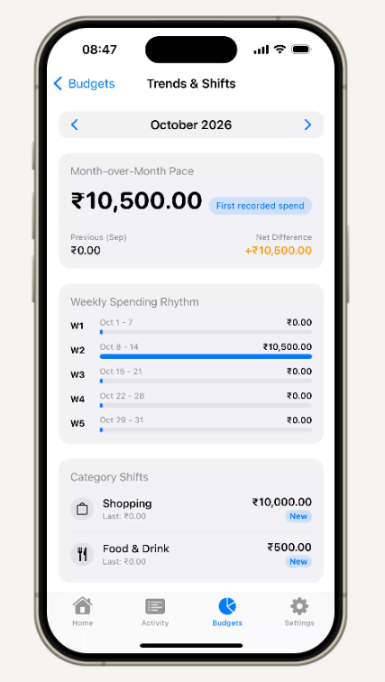
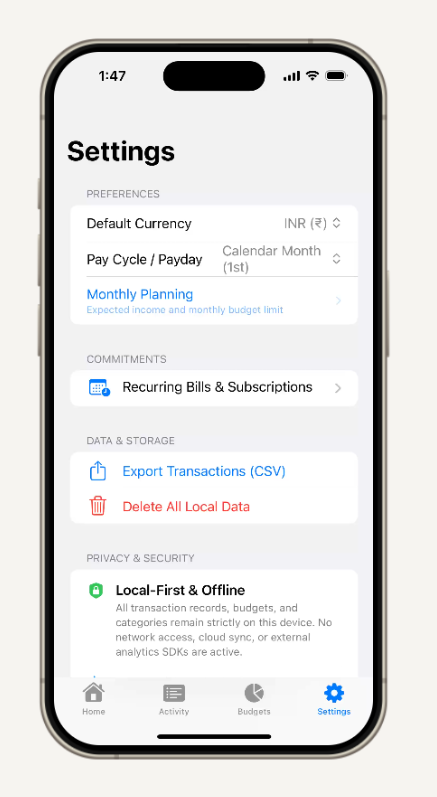

# Expense Tracker for iOS

[](https://github.com/satyam0singh/expense_tracker_app/actions/workflows/ios-ci.yml)


A native, private, and local-first personal finance and expense tracker built for iOS with **SwiftUI** and **Swift 5.10**. Engineered for financial correctness, transparency, and complete on-device data sovereignty.

---

## 📱 Screenshots & Visual Walkthrough

### 1. Onboarding & Core Tracking
| 1. Onboarding & Currency | 2. Add Transaction / Income | 3. Live Dashboard |
| :---: | :---: | :---: |
|  |  |  |
| *Multi-currency selection & planning limits* | *Expense/income logging with payment methods* | *Factual cash flow, budgets & recent activity* |

### 2. On-Device Voice Logging & Natural Review
| 4. Speak an Expense | 5. Review Voice Draft |
| :---: | :---: |
|  |  |
| *100% private, on-device voice capture* | *Automatic NLP parsing for category, amount & note* |

### 3. Financial Analysis & Settings
| 6. Trends & Monthly Rhythm | 7. Settings & Privacy Controls |
| :---: | :---: |
|  |  |
| *Week-by-week spending rhythm & category shifts* | *Pay cycle config, RFC 4180 CSV export & local wipe* |

---

## ✨ Key Highlights

- **🔒 100% Offline & Private:** No third-party servers, no analytics, no bank credential scraping, and zero cloud tracking. Your financial records stay entirely on your device.
- **🎯 Exact Minor-Unit Money Math:** All amounts and limits are computed in 64-bit integer minor units (`Int64`). Floating-point arithmetic is strictly banned to guarantee zero rounding errors.
- **🎙️ On-Device Voice Logging:** Speak naturally to log expenses (e.g. *"Spent 350 rupees on lunch"* or *"₹250 chai, UPI"*). Speech is processed locally, parsed into editable review drafts, and never saved silently or transmitted off-device.
- **⚡ Safe-to-Spend Engine:** Transparent, factual daily spending pace calculated against your pay cycle and upcoming recurring commitments. Explicitly labeled as a planning forecast—never claims to know your bank balance.
- **📊 Rich Trends & Spending Rhythms:** Category-level spending progress bars, week-by-week cadence analysis, and warning thresholds.
- **💾 Complete Data Sovereignty:** One-tap export to standardized RFC 4180 CSV, plus a single-button total data wipe.

---

## 🚀 Live Browser Demo (No Mac Needed)

You can run and interact with the actual compiled iOS application directly inside Google Chrome or Microsoft Edge on Windows, Linux, or macOS using **Appetize.io**:

1. Navigate to the latest successful run on **[GitHub Actions](https://github.com/satyam0singh/expense_tracker_app/actions/workflows/ios-ci.yml)**.
2. Scroll to the **Artifacts** section at the bottom and download **`ExpenseTracker-Simulator`** (or `ExpenseTracker-Simulator-Zip`).
3. Open **[Appetize.io Upload](https://appetize.io/upload)** and drag & drop the downloaded `.zip` file.
4. Select **iPhone 15 Pro (iOS 17+)** and test the app live in your web browser.

---

## 🔍 Feature Architecture & Details

### 1. Daily Pace & Safe-to-Spend (`SafeToSpendCalculation`)
- Calculates remaining daily allowance: `(Starting Pool - Posted Spend - Upcoming Commitments) / Days Remaining`.
- Supports customized pay cycles (calendar month, semi-monthly, or custom payday of month).
- Clearly highlights deficits with a visual indicator without clamping negative amounts.

### 2. Natural Voice Input (`VoiceTransactionParser`)
- Natural-language rule engine parsing amounts, dates (*today, yesterday, kal*), categories (*food, commute, coffee, bills*), and payment methods (*UPI, cash, card*).
- Presents parsed draft fields in an interactive review sheet before committing to storage.

### 3. Factual Category & Budget Tracking
- Multi-currency support (INR `₹`, USD `$`, EUR `€`, GBP `£`, JPY `¥`).
- Dynamic category creation with SF Symbols and customizable hex palettes.
- Configurable budget alert thresholds (e.g. 80% warning badge).
- Transfers and credit card repayments are cleanly segregated from spending totals so transfers do not inflate expense calculations.

### 4. Data Portability & Privacy
- Export all transaction history filtered by date range to RFC 4180 compliant CSV.
- Local JSON file store with atomic write safety and zero external SDK dependencies.

---

## 🏗️ Technical Architecture

The codebase is structured into clean modular layers with strong domain boundaries:

```
expense_tracker_app/
├── Sources/
│   ├── ExpenseTrackerCore/          # Pure Domain Logic & Persistence (No UI Dependencies)
│   │   ├── Domain/                  # Money, Transaction, Budget, PayCycle, SafeToSpend
│   │   ├── Repositories/           # Protocols & LocalFileStore implementations
│   │   └── Utilities/               # CurrencyFormatter, CSVExporter, Minor-unit Math
│   │
│   └── ExpenseTrackerApp/           # Native SwiftUI Presentation Layer
│       ├── App/                     # App Entrypoint & Root Tab Navigation
│       ├── Features/                # Home, Activity, Budgets, Recurring, Trends, Voice, Settings
│       └── Widgets/                 # Lock Screen & Home Screen Widget extensions
│
├── Tests/
│   └── ExpenseTrackerTests/         # 14 Test Suites (73 automated unit & integration tests)
│
├── docs/
│   ├── screenshots/                 # App UI screenshots for documentation
│   └── 00_PRODUCT_BRAIN.md ...      # Complete product, architecture and test specifications
│
├── ExpenseTracker.xcodeproj         # Native Xcode Project (iOS 17.0+ Target)
└── Package.swift                    # Swift Package Manager manifest
```

---

## 🛠️ Building & Testing Locally

### Prerequisites
- macOS 14.0+ (Sonoma)
- Xcode 15.4 or later
- Swift 5.10+

### Option A: Command Line (Swift Package Manager)
Run all 73 domain, parsing, and calculation unit tests:
```bash
swift test
```

### Option B: Command Line (xcodebuild)
Build and test on the iOS Simulator:
```bash
xcodebuild test \
  -project ExpenseTracker.xcodeproj \
  -scheme ExpenseTracker \
  -destination 'platform=iOS Simulator,name=iPhone 15 Pro' \
  -derivedDataPath ./build/DerivedData \
  CODE_SIGNING_ALLOWED=NO
```

### Option C: Xcode IDE
1. Double-click [`ExpenseTracker.xcodeproj`](./ExpenseTracker.xcodeproj) to open in Xcode.
2. Select **iPhone 15 Pro** (or your preferred iOS 17+ device) in the run destination menu.
3. Press **⌘ + U** to run all tests or **⌘ + R** to run the app.

---

## 🧪 Automated CI Pipeline

Every pull request and push to `main` triggers a complete CI validation pipeline hosted on Apple Silicon runners (`macos-14`):

1. **Swift Package Tests:** Validates all 14 test suites and domain logic via `swift test`.
2. **Xcode iOS Simulator Test:** Executes `xcodebuild test` on an active iPhone simulator destination.
3. **App Packaging:** Strips unit test test-runner bundles and zips the clean simulator `.app` bundle.
4. **Artifact Upload:** Publishes `ExpenseTracker-Simulator` artifacts ready for immediate testing on Appetize.io or Mac simulators.

---

## 📜 Product Invariants & Non-Negotiables

- **Money Storage:** Strictly integer minor units (`Int64`). Floating-point types are forbidden in financial calculations.
- **Network & Analytics:** Zero outbound network calls for core tracking. No telemetry, third-party trackers, or crash SDKs that log user transaction details.
- **Auditability:** Complete specification pack, architecture decision records, and requirements traceability are maintained under [`docs/`](./docs/).

---

## 📄 License

This project is licensed under the [MIT License](./LICENSE).
